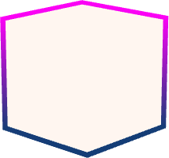

# Easy Outline

**Plugin de Blockbench · Por Pavito · Versión 1.0.8**

Crea contornos de color sólido o degradado para cubos de modelos Generic Model, Bedrock Entity, Bedrock Block y Java Block/Item. Elige el color, el grosor y el nivel de optimización; el plugin crea la geometría y las texturas automáticamente.

## Instalar desde URL

1. En Blockbench Desktop abre **Archivo → Plugins / Complementos → Cargar plugin desde URL**.
2. Pega la dirección directa al archivo `easy_outline.js` de este repositorio. Si los archivos de esta carpeta se subieron a la raíz de la rama `main`, la URL es:

   `https://raw.githubusercontent.com/USUARIO/REPOSITORIO/main/easy_outline.js`

3. Abre un modelo con cubos y usa **Herramientas / Objetos → Easy Outline…**.

Sustituye `USUARIO` y `REPOSITORIO` por los de este repositorio. Si mantienes los archivos dentro de `public/` en GitHub, usa `.../main/public/easy_outline.js`. Mantén `icon.png` junto al JS para que aparezca como icono en la ficha del plugin en Blockbench Desktop.

La instalación desde URL consulta el archivo al volver a abrir Blockbench; para obtener cambios durante la sesión, usa **Recargar** en la ficha del plugin. Guarda tus modelos editables como `.bbmodel`.

## Archivos

- `easy_outline.js`: plugin instalable.
- `icon.png`: icono del plugin y de esta página.
- `README.md`: instrucciones.
- `LICENSE`: licencia MIT.
